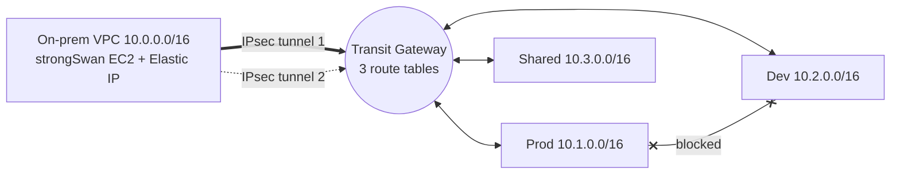

# Hybrid Cloud Connectivity Lab

Simulate an on-premises data center inside AWS and connect it to three AWS VPCs over an
IPsec Site-to-Site VPN through a Transit Gateway. Dev and Prod are isolated from each other;
both can reach a Shared Services VPC; "on-prem" can reach everything.
Includes a design-only section for AWS Direct Connect.

> Everything is Infrastructure as Code (Terraform). Region: `ap-south-1` (Mumbai).

## Architecture



Full diagrams: [`diagrams/architecture.mmd`](diagrams/architecture.mmd) and
[`diagrams/direct_connect_design.mmd`](diagrams/direct_connect_design.mmd).

### Who can reach whom

| From \ To | On-prem | Prod | Dev | Shared |
|---|:-:|:-:|:-:|:-:|
| **On-prem** | - | yes | yes | yes |
| **Prod** | yes | - | **no** | yes |
| **Dev** | yes | **no** | - | yes |
| **Shared** | yes | yes | yes | - |

## Tech used

- AWS: VPC, Transit Gateway (3 route tables), Site-to-Site VPN, Customer Gateway, EC2, Elastic IP, CloudWatch
- Terraform (AWS + local providers)
- strongSwan 5.9 (IKEv2, route-based with xfrm interfaces) on Ubuntu 22.04
- FRR (optional BGP upgrade)
- Bash, Mermaid

## Quick start

Prerequisites: AWS account, AWS CLI configured, Terraform >= 1.5, an EC2 key pair in `ap-south-1`.

```bash
# 1. Configure
cd terraform
cp terraform.tfvars.example terraform.tfvars      # edit my_ip_cidr and key_name

# 2. Build the AWS side (VPCs, TGW, VPN, EC2s). Also writes onprem/swanctl.conf + onprem/lab.env
terraform init
terraform plan
terraform apply

# 3. Configure the strongSwan "on-prem" box
cd ..
scp -i ~/.ssh/<key>.pem -r onprem ubuntu@$(terraform -chdir=terraform output -raw onprem_public_ip):~/
ssh -i ~/.ssh/<key>.pem ubuntu@$(terraform -chdir=terraform output -raw onprem_public_ip) \
    'cd onprem && sudo ./install_strongswan.sh'

# 4. Test (prints PASS/FAIL)
KEY_FILE=~/.ssh/<key>.pem ./tests/connectivity_tests.sh
```

Optional: set `vpn_routing_mode = "bgp"` in `terraform.tfvars`, re-apply, and re-run step 3 to switch to dynamic routing.

## Repository layout

```
terraform/   all AWS infrastructure
onprem/      strongSwan install script + config templates
diagrams/    Mermaid diagrams
tests/       connectivity_tests.sh
```

## Cost warning

The VPN connection and four Transit Gateway attachments bill **per hour**, even when idle.
Tear the lab down the same day.

## Teardown

```bash
cd terraform
terraform destroy
```

Then confirm in the console that no VPN connections, TGW attachments, or Elastic IPs remain.

## Security notes

- Pre-shared keys are `sensitive` outputs and are **never committed**.
- `terraform.tfstate`, `terraform.tfvars`, `*.pem`, and the generated `onprem/swanctl.conf` are gitignored.
- SSH is allowed only from your own IP; the Direct Connect section is design-only (no circuit is provisioned).
